# ATP UI v2: redesign proposal

Status: **approved by Abhi on 20 Oct 2026**, with the provisional default for every open question UI-1 to UI-14 (section 13), plus
three additions from the owner's no-sample-data brief (`ATP_SESSION_NO_SAMPLE_DATA.md`):

- **No sample data anywhere a user sees data.** A page with no real data shows the broker gate or a friendly empty state, never
  generated bars, chains or figures.
- **A "Connect your broker" / "Log in to <Broker>" gate on every data page**, built in UI2-0 (component) and UI2-1 (wired into
  the shell for every data route).
- **One timeframe list on every chart, including W (weekly) and M (monthly)**, in UI2-4.

The roll-out (section 12) runs behind the `ui_v2` flag, page by page; the old layout stays until Abhi switches the flag on.
Read from `origin/main` at `f6d6b2c` (AMW-1, #266). Mockups use illustrative numbers only.

Contents

1. Summary
2. Navigation map (every route and sidebar item)
3. Merges and renames
4. Mobile bottom navigation
5. Dashboard spec
6. Charts page spec
7. Signals page spec
8. Visual system and design tokens
9. Ease of use: rules for every page
10. Connect broker flow and broker field map
11. Setup wizard
12. Roll-out plan
13. Open questions (UI-1 to UI-14)
14. Mockup index

---

## 1. Summary

- **One question per page.** Each page gets a plain-language title and one primary action. Secondary details go behind "More" or into a drawer.
- **Navigation.** Today there are 28 sidebar items in 6 groups. v2 has 21 items in five collapsible sections (Markets, Strategies, Trading, Insights, Account), each with 3 to 5 items. Four rarely used tools go under **More**. The Admin console is shown only to the platform operator. A page whose feature flag is off is hidden.
- **Mobile.** The bottom bar becomes Home, Charts, Signals, Positions, More. "More" opens a sheet with search and every other page.
- **Two new pages.**
  - **Charts** (`/charts`). Today a chart only opens as a separate `?chart=` browser tab.
  - **Signals** (`/signals`), rebuilt as an inbox for approvals and today's signals. The current page is a developer-style signal generator with "Sample data seed" inputs.
- **Dashboard.**
  - It starts with a market strip: NIFTY, BANK NIFTY, VIX, open or closed, broker connection and today's P&L.
  - Then, in order: Needs attention, Open positions, Active signals, and a 4-tile Today summary.
  - Removed from the dashboard: worker status, backend status, the "Engines behind this console" block, the strategy mix, the go-live checklist and the OI banner block.
- **Visual system.** v2 extends the existing P1.2/U5 tokens (`tokens.css`, `palette.css`, `tailwind.config.js`, the Storybook "Design system/Tokens" story). It does not add a second system. Colour carries meaning only:
  - green and red for price direction and P&L;
  - brand blue for the primary action and the current selection;
  - amber for real warnings;
  - greys for everything else.
- **Connect broker.** A 3-step guided flow (choose → enter that broker's keys → connect) replaces today's 8-field form and its "Authenticate" button. The fields come from one per-broker field map in the backend registry, and the same map drives validation.
- **Setup wizard.** 4 steps (broker → risk → first strategy → alerts), skippable and resumable. A "Setup 2 of 4" chip stays on the dashboard until it is done.
- **Roll-out.** Behind a new flag, **`ui_v2`**, off by default. It ships in 11 PRs, page by page. The old layout stays until Abhi switches. Every PR carries before/after screenshots and adds v2 visual-regression baselines without touching the old ones.

Key findings from reading the code (these shape the plan):

1. **No charts route.** `routes.ts` has no charts page. Charts open as standalone windows (`?chart=`, `?workspace=1`, `?contract=`, `?basis=`) handled in `App.tsx`.
2. **The Signals page is not a signals inbox.** `SignalsPage.tsx` generates a signal on demand, with "Sample bars" and "Sample data seed" inputs. Approvals live in Copilot → Watchtower (`/ai/actions`, including Z3 `ENTRY` approvals). Signal history (`/signal-history`) is written only by that manual generator. No endpoint lists "today's signals" across Autopilot, scans and Copilot.
3. **The broker form sends all 8 credential fields for every broker.** `SettingsPage.tsx` `CRED_FIELDS` includes access and request tokens. The adapters need different subsets (§10).
4. **Zerodha and Fyers still make the user paste a code.** Their login flow (`LOGIN_URL_BROKERS`) asks for the pasted `request_token` / `auth_code`. Only Upstox has a server callback.
5. **Some brokers have no daily login method today.** Angel One, Shoonya and Dhan fall back to `login_method = "manual"`, and no morning auto-login job exists.
6. **Shoonya gets the raw TOTP secret.** It passes `totp_secret` straight through as `factor2`. Angel One converts the secret to a code (`_totp_code`) and Shoonya does not, so unattended Shoonya login would fail.
7. **Number formatting is copied six times.** There are six separate `money()`/`pct()` helpers (`paperTicket.ts`, `journal/format.ts`, `portfolio/model.ts`, `optionsBuilder/model.ts`, `copilot/tabs/shared.tsx`, `screener/etf.ts`).
8. **The feature list is fetched separately in each component.** `api.myFeatures()` is called independently by `App.tsx`, `ChartWindow`, `ChartWorkspace`, `PositionsPage`, `ScreenerPage` and the alert cards. The sidebar never reads it, so pages whose flag is off are still listed. For example, Journal shows "The discipline engine is turned off… discipline_engine feature".

---

## 2. Navigation map

Sources: `frontend/src/routes.ts` (29 page ids), `frontend/src/App.tsx` (standalone windows, legacy forwards), `frontend/src/components/Sidebar.tsx` (`NAV_GROUPS` + `ADMIN_GROUP`), `frontend/src/components/BottomNav.tsx`.

Visibility rules:

- **"all"**: every signed-in role.
- **Flag**: the item is hidden while that feature flag is off for the organisation. The flag is read once in the shell through a shared `useFeatures()` hook.
- **Role**: the item is hidden for the other roles.

| # | Current route | Current sidebar (group / label) | v2 section | v2 sidebar label | v2 page title (the one question) | Visibility |
|---|---|---|---|---|---|---|
| 1 | `/` (dashboard) | Overview / Dashboard | Markets | Dashboard | **Today** ("What needs me right now?") | all |
| 2 | none (`?chart=SYM`, `?workspace=1` windows) | none | Markets | Charts | **Charts** ("What is this symbol doing?") at the new `/charts` and `/charts/:symbol` | all. "Layout" (multi-chart) only with `chart_workspace` |
| 3 | `/option-chain` | Research / Option Chain | Markets | Option chain | **Option chain** ("Where are traders positioned?") | all |
| 4 | `/options-builder` | Research / Options Builder | Markets, merged into Option chain | none (tab "Plan a trade") | Tab "Plan an options trade" at `/option-chain/plan` | flag `options_builder` |
| 5 | `/screener` | Trade / Screener | Markets | Find setups | **Find setups** ("Which symbols match my idea?"), tab "Ready-made screens" | all |
| 6 | `/scanner` | Trade / Market Scanner | Markets, merged into Find setups | none (tab "Custom scan") | Tab "Custom scan" at `/screener/custom` | all |
| 7 | `/strategies` | Trade / Strategy Library | Strategies | Library | **Strategy library** ("Which strategy fits me?") | all |
| 8 | `/strategy-builder` | Trade / Strategy Builder | Strategies | Build a strategy | **Build a strategy** | all |
| 9 | `/backtest` | Trade / Backtesting | Strategies | Test a strategy | **Test a strategy** ("How would it have done?") | all |
| 10 | `/copilot/:tab` (+ legacy `/ai-copilot/:tab`) | Trade / AI Copilot | Strategies | AI Copilot | **AI Copilot** | flag `ai_copilot` |
| 11 | `/deployments` | Trade / Autopilot | Strategies | Autopilot | **Autopilot** ("What is running for me?") | all |
| 12 | `/marketplace` | Trade / Marketplace | More | Marketplace | **Strategy marketplace** | flag `marketplace` |
| 13 | `/signals` | Trade / Signals | Trading (and the bottom bar) | Signals | **Signals** ("What should I act on?"), rebuilt as an inbox (§7) | all |
| 14 | `/positions` | Portfolio / Positions | Trading | My positions | **My positions** ("What do I hold and how is it doing?") | all |
| 15 | `/orders` | Portfolio / Orders | Trading | Orders | **Orders and fills**, tabs Orders / Trade history | all |
| 16 | `/portfolio` | Portfolio / Portfolio | Trading | Portfolio | **My portfolio** ("Where is my money?") | all |
| 17 | `/risk-management` | Portfolio / Risk Management | Trading | Risk | **Risk limits** ("How much can I lose today?") | all |
| 18 | `/analytics` | Portfolio / Analytics | Insights | Performance | **How am I doing?** | all |
| 19 | `/journal` | Portfolio / Journal & Discipline | Insights | Journal | **Journal**, tabs Trades / Coach / Discipline | flag `discipline_engine` |
| 20 | `/coach` | Portfolio / Coach & Guide | Insights, merged | none | The trade coach becomes Journal's "Coach" tab. The guide becomes the global Help panel ("?") | flag `discipline_engine` for the tab; Help for all |
| 21 | `/news-events` | Research / News & Events | Insights | News & events | **News & events** ("What could move my stocks?") | all. News feed section only with `news_feed` |
| 22 | `/fundamentals` | Research / Fundamental Analysis | Insights | Company research | **Company research** | all |
| 23 | `/quant` | Research / Factor Lab | More | Factor Lab | **Factor Lab** | all (in More) |
| 24 | `/instruments` | Research / Instruments | More | Contract specs | **Contract specs** | all (in More) |
| 25 | `/settings` | System / Settings | Account | Settings | **Settings**, groups Brokers · Risk · Alerts · Account · Setup, with search | all |
| 26 | `/account` | none (top bar avatar + sidebar footer) | Account, merged into Settings → Account | none | Signed in: Settings → Account. Signed out: `/account` stays the sign-in, register, reset and invite page | all |
| 27 | `/team` | System / Team | Account | Team | **Team** | all can view. Invite and role changes for OWNER only (as today) |
| 28 | `/system-logs` | System / System Logs | More | Activity log | **Your account activity** | all (in More) |
| 29 | `/notifications` | System / Notifications | Account (also the top-bar bell) | Notifications | **Notifications** | all |
| 30 | `/admin` | Platform / Admin Console (SUPER_ADMIN) | More, role-only | Admin console | **Admin console** | role `SUPER_ADMIN` only |

Standalone and special routes (unchanged behaviour unless stated):

| Current | v2 |
|---|---|
| `?chart=SYM&tf=…` (ChartWindow, its own tab) | Kept as "Open in new tab" from Charts. It renders the same v2 chart with no shell. |
| `?workspace=1` (ChartWorkspace, flag `chart_workspace`) | Kept. Also reachable as Charts → "Layout" (1/2/4 charts) while the flag is on. |
| `?contract=…`, `?basis=…` windows | Kept. Opened from Option chain (contract) and Charts → More (futures basis). |
| `/status` (public status page, flag `public_status_page`) | Unchanged. Linked from Help → "Service status" while the flag is on. |
| `/legal/:slug` | Unchanged. Linked from Settings → Account → Legal. |
| `/?broker=…` (Upstox OAuth return), `/?verify=`, `/?reset=`, `/?invite=`, `/?page=` | Same forwarding. `?broker=` lands on Settings → Brokers and shows the Connect flow's step 3. |
| Old paths `/scanner`, `/options-builder`, `/coach`, `/account` (signed in) | Redirect to their new tabs while `ui_v2` is on. |

**Counts.**

| | Today | v2 |
|---|---|---|
| Primary sidebar items | 27 + 1 admin | 21 |
| Items under More | none | 4 (+ Admin console for SUPER_ADMIN only) |

The v2 sections:

| Section | Items |
|---|---|
| Markets | 4 |
| Strategies | 5 |
| Trading | 5 |
| Insights | 4 |
| Account | 3 |

Deviation from the brief: **Signals is added to Trading**, the brief's 4 items plus Signals, so 5 items. The brief wants signals one tap away, and the desktop sidebar needs a home for the page the bottom bar links to.

---

## 3. Merges and renames

### Merges (each with its reason)

| ID | Merge | Into | Reason |
|---|---|---|---|
| M1 | Screener (`/screener`) + Market Scanner (`/scanner`) | **Find setups**, tabs "Ready-made screens" and "Custom scan" | Both answer "which symbols match my conditions?" with the same building blocks. Two sidebar entries made traders guess which to use. |
| M2 | Options Builder (`/options-builder`) | **Option chain** tab "Plan a trade" | The builder starts from the chain's strikes and expiries. One underlying picker serves both. |
| M3 | Coach & Guide (`/coach`) | Trade coach → **Journal** "Coach" tab. Guide → global **Help** panel ("?" in the top bar, next to the support bot) | The coach reviews your own trades, so it belongs with your journal. The guide explains concepts, so it is help, not a page. This also removes the second "Coach" next to Copilot's coach tab (see R13). |
| M4 | Account page (signed-in part: email, MFA, password, sessions, permissions) | **Settings → Account** | One place for "my settings". The top-bar avatar opens Settings → Account. |
| M5 | Positions page "Trade history" card | **Orders** page, tab "Trade history" | Positions answers "what do I hold now?". Closed trades are history, beside the fill blotter that is built from the same `/trades` data. |
| M6 | Signals page's on-demand generator ("Generate a signal", sample bars and seed) | **Strategy library** → strategy drawer → "Try it on a symbol" (sample-data inputs under Advanced) | The generator is a strategy-exploration tool. `/signals` becomes the inbox traders expect. |
| M7 | Copilot → Watchtower **ENTRY approvals** | **Signals → "Waiting for you"** (same `/ai/actions` data and `ProposalCard` logic) | Approvals must be one tap away (bottom bar), not three tabs deep in Copilot. Watchtower keeps its non-entry actions (pause, exit, reduce risk) and links to Signals. |
| M8 | Chart window (`?chart=`) + chart workspace (`?workspace=1`) | **Charts** page (`/charts`) with "Layout" and "Open in new tab" | Charts become a first-class page inside the app and a bottom-bar destination. The windows keep working. |
| M9 | Dashboard go-live checklist (`GoLiveChecklist kind="tenant"`) | **Settings → Setup**, together with the setup wizard | Readiness is setup, not daily trading. |
| M10 | Dashboard "Market pulse" mini-charts and "Option-chain OI" banner block | The dashboard **market strip** (one OI line per index) + **Charts** watchlist + **Option chain** | The same market state is shown once, compactly. Full OI banners stay on Option chain. |
| M11 | Settings broker cards: "Broker session health", "Connected brokers", "Add / update broker credentials", Broker accounts, Static IP | **Settings → Brokers**: one list + the Connect flow | Five cards about one subject become one list with status chips and one guided flow (§10). |
| M12 | Settings integrations cards: TradingView webhook, API keys, AI provider, Vision BYOK, Billing | **Settings → Account** sub-groups "Plan and billing" and "Integrations" | Grouped by purpose, found through settings search. |
| M13 | Risk Management page limits + any Settings risk form | One risk form, rendered at `/risk-management` and in **Settings → Risk** | The same component in two places, so there are never two different "risk" forms. |

### Renames (labels and wording a user sees)

| ID | Today | v2 |
|---|---|---|
| R1 | Screener / Market Scanner | Find setups |
| R2 | Strategy Library | Library (title "Strategy library") |
| R3 | Strategy Builder | Build a strategy |
| R4 | Backtesting | Test a strategy |
| R5 | Positions | My positions |
| R6 | Risk Management | Risk (title "Risk limits") |
| R7 | Analytics | Performance (title "How am I doing?") |
| R8 | Journal & Discipline | Journal |
| R9 | Fundamental Analysis | Company research |
| R10 | Instruments | Contract specs |
| R11 | System Logs | Activity log |
| R12 | Dashboard greeting page | Title "Today" on mobile, greeting on desktop |
| R13 | Copilot tab "Coach" | "Scorecard" (it grades the Copilot's own calls) |
| R14 | "Authenticate" (broker) | **"Log in to <Broker>"** |
| R15 | "Store credentials" | **"Connect <Broker>"** |
| R16 | "Deploy a strategy" | "Start on Autopilot" |
| R17 | Sidebar "PAPER MODE" badge | A small "Paper" chip (neutral, not amber) |
| R18 | Top-bar "MAINTENANCE: no new entries" | "Maintenance: new trades are paused" |

### Developer wording removed from trader screens

All of the following go:

- "Backend online/offline";
- "Autopilot trading · beat 12s ago";
- "Engines behind this console";
- "registry", "adapters", "Phase…", "flag `x`", "503";
- "Sample data seed" and "Sample bars" (kept only under Advanced in M6);
- raw `String(e)` error text;
- "The discipline engine is turned off… a platform operator can turn on the discipline_engine feature" (the page is hidden instead).

Errors use the pattern **what happened + what to do next**. For example: "Upstox did not accept the login. Log in again; if it repeats, check the Redirect URL in your Upstox app."

---

## 4. Mobile bottom navigation

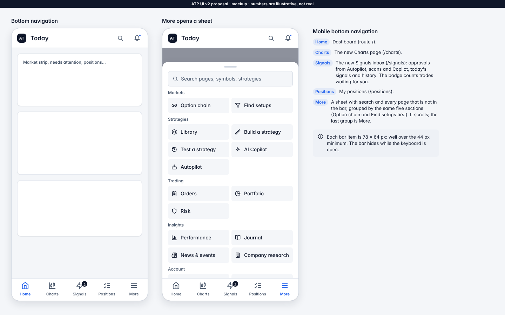

| Slot | Today (`BottomNav.tsx`) | v2 | Route |
|---|---|---|---|
| 1 | Home | **Home** | `/` |
| 2 | Screener | **Charts** | `/charts` (new) |
| 3 | Chain | **Signals** (badge = trades waiting for approval) | `/signals` |
| 4 | Positions | **Positions** | `/positions` |
| 5 | More (opens the sidebar drawer) | **More** (opens a bottom sheet) | none |

The More sheet holds search plus every page not in the bar, grouped by the same five sections. Markets comes first (Option chain, Find setups), then Strategies, Trading (Orders, Portfolio, Risk), Insights, Account and More.

**What "Signals" maps to in today's routes.** The new `/signals` page combines data that today is spread over three places:

1. `/copilot/watchtower`: pending approvals, `GET /api/ai/actions?status=PENDING`, `action = "ENTRY"` (Z3 approval-only entries and N1 scan-then proposals). The approve, reject and snooze actions are reused as they are.
2. Scan alert matches: `GET /api/alerts/rules/{id}/events`, per rule only today.
3. `/signals`: `GET /api/signal-history`, the "Recent signal history" list at the bottom of today's page.

Today's generator moves to the Library (M6).

The tap targets keep the PW2 rules: bar items are about 78 × 64 px, with 44 px minimum targets elsewhere. The bar hides while a text field is focused.

---

## 5. Dashboard spec

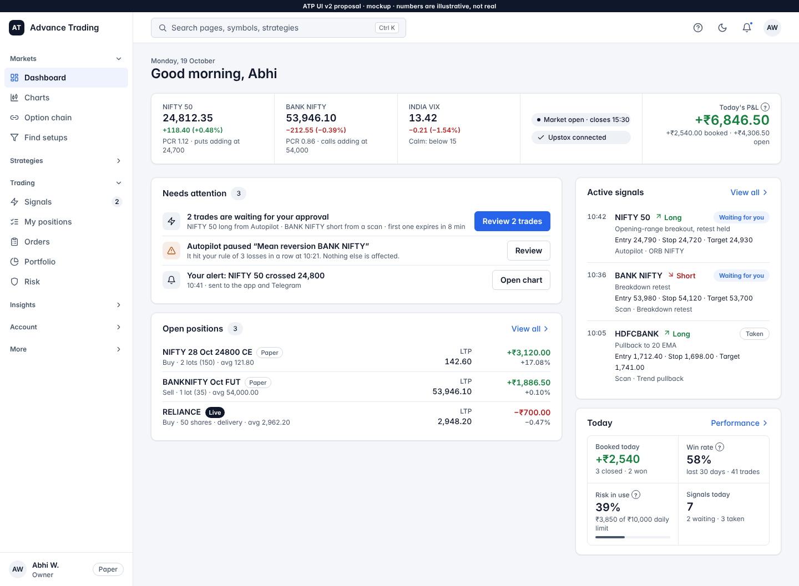
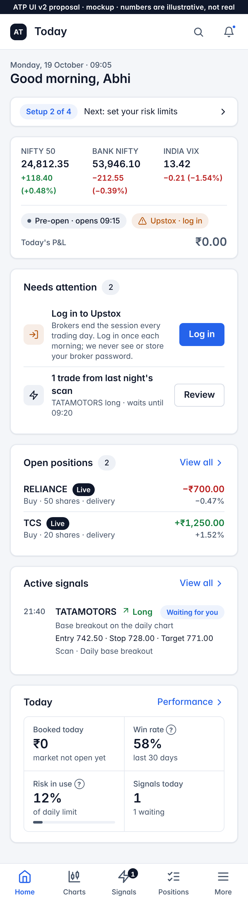

The mobile mockup shows the 09:05 "not logged in yet" state with the Setup chip. The desktop mockup shows the mid-day state.

**Order, top to bottom:**

1. Greeting
2. Setup chip (only until setup is done)
3. Market strip
4. Needs attention
5. Open positions
6. Active signals
7. Today summary

On desktop: the strip runs full width, Needs attention and Open positions form the left column (2/3), and Active signals and Today form the right column (1/3). On a phone everything is one column, in the order above.

There is **one primary button** on the screen: the first item in Needs attention.

### Data behind each block

| Block | Shows | Feeds (existing unless marked new) |
|---|---|---|
| Market strip: indices | NIFTY 50, NIFTY BANK, INDIA VIX: last price, change, % change | **New** `GET /api/market/strip`, read-only (UI-3). It reads the LTP hub / `GET /api/market-data/ltp` for the three symbols, with a fallback to the `GET /api/ai/market-memory` cues (`INDIA VIX` already lives there). It is one call instead of three rate-limited LTP calls. |
| Market strip: OI line | One line per index, e.g. "PCR 1.12 · puts adding at 24,700" | `GET /api/option-chain/banners` (today's `OiBannersCard`): first sentence plus PCR only |
| Market strip: market state | "Market open · closes 15:30" / "Pre-open · opens 09:15" / "Closed · holiday (Diwali)" | `GET /api/system/worker-status`, fields `market_open`, `market_status` and `next_market_open` only. Heartbeat and worker internals are not shown. Plus `GET /api/market-holidays`. |
| Market strip: broker chip | "Upstox connected" (neutral) / "Upstox · log in" (amber) / "2 brokers · 1 needs login" | `GET /api/broker/token-status` (`needs_login`, `token_status`) |
| Market strip: today's P&L | Realised + unrealised since the open, with "booked" and "open" split | `GET /api/portfolio/exposure` (`realised_today`, `unrealised_pnl`) |
| Needs attention | Up to 5 rows, most urgent first: approvals waiting; broker login needed; Autopilot paused or errored; daily-loss lockout; triggered alerts not yet seen; LIVE paused by the operator; email not verified (before LIVE) | `GET /api/ai/actions?status=PENDING`; `GET /api/broker/token-status`; `GET /api/deployments` (status `PAUSED` / `last_error`); `GET /api/paper/risk` (`lockout`); `GET /api/notifications?unread_only=true`; `GET /api/system/status` (`disabled_brokers`, maintenance); auth user `email_verified` |
| Open positions | Up to 5 rows: symbol, side + lots/qty + avg, LTP, P&L ₹ and %, Paper/Live chip. "View all" goes to My positions. | `GET /api/positions` + LTP from `GET /api/portfolio/exposure?live_prices=true` (as the Positions page does today) |
| Active signals | Up to 3 of today's signals: time, symbol, Long/Short, setup, entry/stop/target, source, status. "View all" goes to Signals. | **New** `GET /api/signals/feed?since=today&limit=3` (§7, UI-4) |
| Today (max 4 tiles) | Booked today · Win rate (30 days) · Risk in use (% of daily limit) · Signals today | `GET /api/portfolio/exposure` (`realised_today`, `risk_at_stops`); `GET /api/analytics/summary` (`win_rate`, `closed_trades`); `GET /api/paper/risk` (`today.used`, `today.limit`); the signals feed count |

Refresh: positions, P&L and attention every 30 s, as today. The strip every 15 s during market hours and every 5 min outside them.

### Removed or moved

| Today on the dashboard | Where it goes |
|---|---|
| "Backend online/offline" badge | Removed. A failure shows as a plain-language banner only when data cannot load. The operator sees health in Admin console and `/status`. |
| "Autopilot trading · beat Ns ago" + market badge | The market state stays in the strip. Worker state goes to Autopilot ("Running" / "Paused") and Admin console. |
| Exposure warning badge | Becomes a Needs attention row only when it is a real warning. |
| 6 coloured KPI tiles (Net P&L, Win rate, Open positions, Deployments, Broker funds, Strategies) | 4 neutral tiles in Today. Net P&L (all time) → Performance. Deployments → Autopilot. Broker funds → Portfolio and Settings → Brokers. Strategies count → Library. |
| Buttons "Deploy a strategy", "Positions", "AI Copilot" in the header | Removed. These are one tap away in the nav and the command bar. |
| Market pulse (live 5-minute mini charts) | Charts page + watchlist (M10) |
| Option-chain OI banners card | One OI line per index in the strip. The full banners stay on Option chain. |
| P&L by strategy bars | Performance |
| Strategy mix ring | Library (filter counts) |
| Exposure by symbol | Portfolio |
| Running deployments list | Autopilot. Paused or errored ones surface in Needs attention. |
| Latest alerts list | Needs attention (unseen triggered alerts) + Notifications |
| Go-live checklist | Settings → Setup (M9) |
| "Engines behind this console" | Removed (product marketing, developer wording) |
| Signed-out KPI tiles (MTF combos, adapters) | Removed. A signed-out user sees the sign-in page. |

### Empty states (friendly, with one action)

| Block | Empty state |
|---|---|
| No broker | "Connect your broker to see live prices and your positions." [Connect a broker] |
| Needs attention empty | "All clear. Nothing needs you right now." (The card collapses to one line.) |
| No positions | "No open positions. Find a setup or let Autopilot trade for you." [Find setups] |
| No signals | "No signals yet today. Your scans and Autopilot strategies post them here." [Set up a scan] |
| Market closed | The strip shows the last close with "Closed · opens Tue 09:15". |

---

## 6. Charts page spec

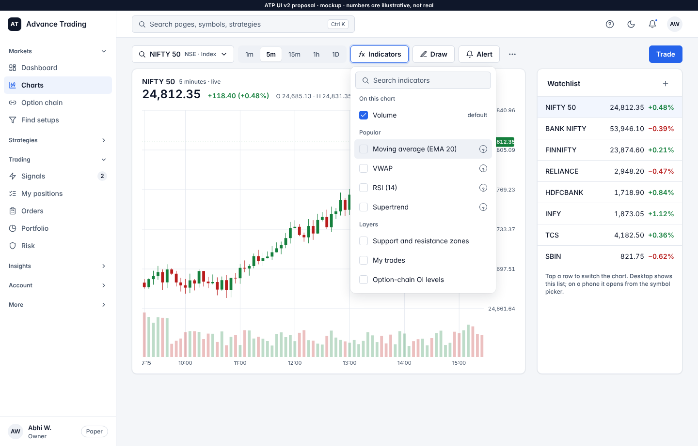
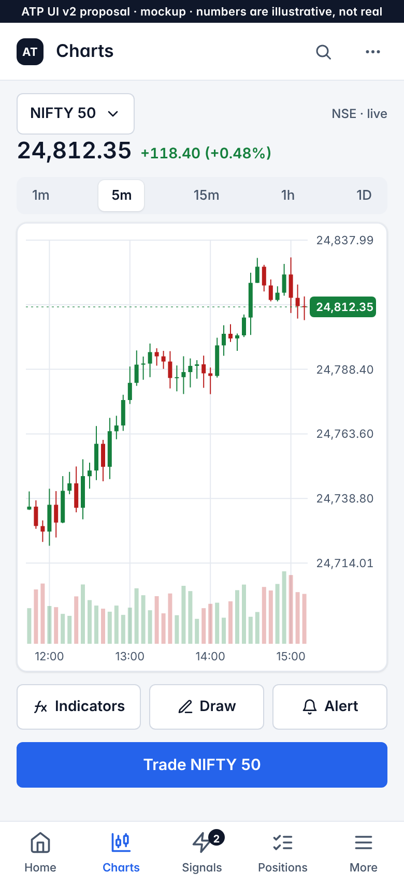

- **One question:** "What is this symbol doing?"
- **Default state:**
  - the last symbol viewed, or NIFTY 50 on first use;
  - 5-minute candles plus a volume pane, and nothing else;
  - live price line, a crosshair on hover or touch, and scroll-back history (the `useBrokerChart` / `loadOlder` already used by `ChartWindow`).
- **Today's defaults.** `ChartWindow` opens with `defaultIndicators={["ema_fast","ema_slow","vwap","volume","rsi"]}`. v2 opens with `["volume"]`. A user's own indicator choice is remembered per user.

**Where the controls live (desktop, one toolbar row above the chart):**

| Control | Place |
|---|---|
| Symbol picker (search, recent, watchlist) | Toolbar, left. The same `SymbolPicker` used on every page (§9). |
| Interval: 1m 5m 15m 1h 1D | Toolbar segmented control |
| **Indicators** menu | Toolbar button that opens a searchable menu with three groups: • On this chart (Volume); • Popular (EMA, VWAP, RSI, Supertrend…), each with a "?" tooltip; • Layers: Support and resistance zones (`market_zones`), Price action (`chart_price_action`), My trades (`chart_trades_layer`), Option-chain OI levels, Studies (`chart_studies`), Expected move (`decision_tools`). A layer whose flag is off is not listed. |
| Draw | Toolbar button (the CH tools: trend line, horizontal line, rectangle, measure) |
| Alert | Toolbar button that creates a price alert at the crosshair price |
| More (⋯) | Replay (CH3), Compare, Layout (multi-chart, `chart_workspace`), Futures basis, Open in new tab, Download image |
| **Trade** (primary) | Toolbar, right. Opens the paper or live ticket in a side drawer. |
| Watchlist | Desktop: a right column (300 px), tap a row to switch. Phone: inside the symbol picker. |

On a phone, the interval control sits under the price. Indicators, Draw and Alert become three 44 px buttons under the chart, with a full-width "Trade NIFTY 50" button below them. More is in the top bar.

---

## 7. Signals page spec

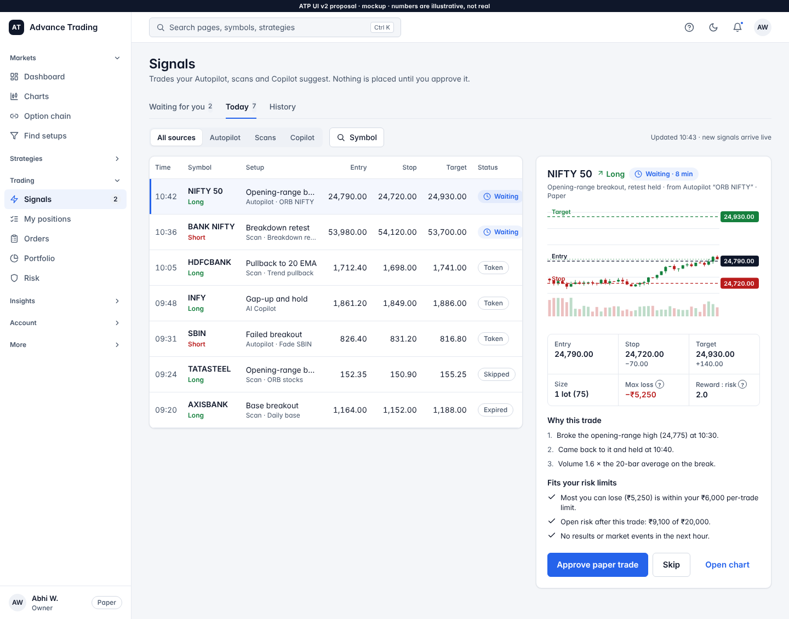
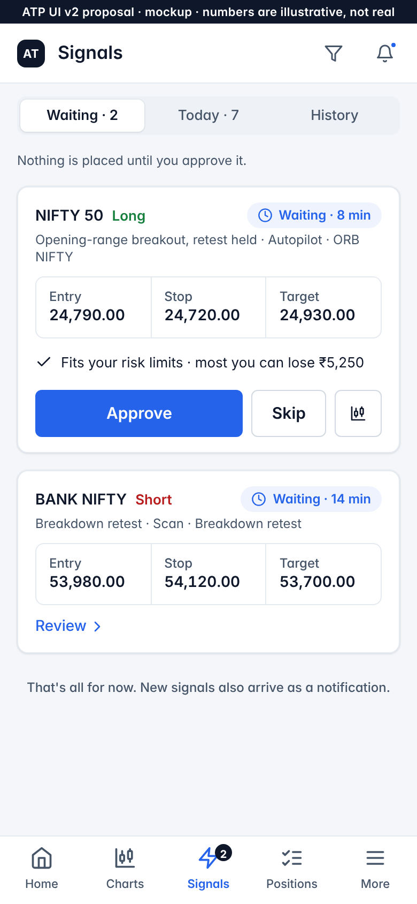

- **One question:** "What should I act on?"
- **Subtitle:** "Trades your Autopilot, scans and Copilot suggest. Nothing is placed until you approve it."
- **Default state:**
  - **phone:** the "Waiting for you" tab;
  - **desktop:** the "Today" tab with the first waiting signal selected.
- **Tabs:** Waiting for you (count) · Today (count) · History (30 days, paged).
- **Filters:** a segmented control for All sources / Autopilot / Scans / Copilot, plus a symbol picker. That is all.
- **List columns (desktop):**
  - Time;
  - Symbol + Long/Short (green or red, as price direction);
  - Setup, with the source as a caption;
  - Entry, Stop, Target;
  - Status chip: Waiting (brand tint, the current selection colour), or Taken / Skipped / Expired (neutral outline).
- **Detail panel (desktop right column; phone: the card expands):**
  - Header: symbol, direction, time left before it expires, source and mode (Paper/Live).
  - A mini chart with Entry (neutral), Stop (red) and Target (green) lines.
  - Six key figures: entry, stop (±), target (±), size in lots (qty), max loss ₹ ("?"), reward : risk ("?").
  - "Why this trade": up to 3 reasons, from the signal's `reasons`.
  - "Fits your risk limits": the result of the existing risk pre-check (`proposals/riskCheck.ts`, `RiskCheckPanel`), written as sentences.
  - **One primary action, "Approve paper trade"** ("Approve live trade" for LIVE, with step-up as today), plus "Skip" and "Open chart".
  - The snooze action stays under More (⋯).

**Data (new, read-only): `GET /api/signals/feed?tab=waiting|today|history&source=&symbol=&cursor=`.** It merges four sources:

- pending and decided `ai_actions` with `action = ENTRY`;
- scan alert rule events for the user's rules (`/alerts/rules/{id}/events` today, per rule);
- Autopilot entry intents and fills of today (`execution_core` intents / deployment trades);
- `signal_history` rows.

It returns one normalised row shape: `{id, at, symbol, direction, setup, entry, stop, target, rr, source:{kind,name}, mode, status, expires_at, reasons[], action_id?}`.

Approve, skip and snooze call the existing `/ai/actions/{id}/approve|reject|snooze`. The new endpoint places no order and changes no state. A source whose flag is off contributes nothing.

---

## 8. Visual system and design tokens

**Reuse first.** The existing system stays the base:

- `frontend/src/styles/tokens.css`: P1.2 semantic tokens, U5 radii, row height and type notes;
- `frontend/src/styles/palette.css`, generated by `scripts/gen-palette.mjs`: Tailwind hues remapped per theme and for the colour-blind option;
- `tailwind.config.js`: semantic colours, `t12…t32` type, `rounded-control/panel`, `shadow-card`;
- `src/components/primitives` (Button, Input, Select, Dialog/Sheet, Tabs, Table, Badge, EmptyState, Skeleton, Signed, PageHeader);
- Storybook `Design system/Tokens` and `Primitives` stories.

v2 **adds** a few tokens and **narrows usage**. It changes no existing token value. `palette.css` stays generated as it is. v2 components are not allowed to use raw palette hues (`text-sky-300`, `bg-violet-…`); a lint script enforces this (§12, UI2-0).

### Colour (values are the existing tokens; "new" marks additions)

| Token | Light | Dark | Use in v2 (only) |
|---|---|---|---|
| `--surface` | 244 246 249 `#F4F6F9` | 9 12 18 | Page background |
| `--surface-1` | 255 255 255 | 16 20 29 | Cards, sidebar, top bar |
| `--surface-2` | 238 241 246 | 23 29 43 | Inputs (read-only), chips, hover |
| `--surface-3` | 226 231 239 | 30 37 54 | Pressed |
| `--border` | 211 217 227 | 36 44 63 | Inputs, buttons |
| `--border-subtle` **new** | 229 233 240 | 26 33 48 | Card outlines, dividers, table rows |
| `--fg` | 15 23 42 | 241 245 249 | Text, "Live" chip fill, done-check fills |
| `--fg-muted` | 71 85 105 | 194 202 216 | Labels, captions (AA on every surface) |
| `--brand` / `--brand-fill` | 37 99 235 | 59 130 246 / fill 29 78 216 | **Only** primary buttons, links, focus ring, current nav item, selected tab or segment, "Waiting" chip |
| `--up` | 21 128 61 | 34 197 94 | **Only** rising price, profit, Long, target level |
| `--down` | 185 28 28 | 239 68 68 | **Only** falling price, loss, Short, stop level |
| `--warn` | 180 83 9 | 245 158 11 | **Only** real warnings: login needed, broker error, paused by a rule, validation error, near a limit |
| `--warn-tint` **new** | 255 251 235 | 41 30 10 | Background of a warning note |
| `--info`, `--ai`, `--ai-2`, `--signal`, `--armed` | unchanged | unchanged | Not used on v2 trader screens. `--ai` stays inside Copilot only. "Armed" or LIVE shows as the neutral dark "Live" chip. |

Rules that follow from the brief:

- A successful state ("Connected", "Done", a valid field) is **neutral with a check icon**, never green.
- Error chips are amber with an icon and a reason.
- A destructive action is a neutral button with a confirm dialog that names the consequence (UI-11).
- The colour-blind option keeps working unchanged: `data-cvd` swaps `--up`/`--down`.

### Spacing (4-pt grid, the U5 rule made explicit)

| Token | Value | Typical use |
|---|---|---|
| `--space-1` | 4 | Icon to text in a chip |
| `--space-2` | 8 | Between buttons |
| `--space-3` | 12 | Inside list rows |
| `--space-4` | 16 | Mobile gutter, card padding (mobile), gap between cards (mobile) |
| `--space-5` | 20 | Card padding (desktop) |
| `--space-6` | 24 | Gap between cards (desktop), page top padding |
| `--space-8` | 32 | Desktop gutter, gap between page sections |
| `--space-10`, `--space-12` | 40, 48 | Page bottom padding, empty-state padding |

Layout:

| Viewport | Layout |
|---|---|
| Phone, < 768 | One column, 16 px gutter |
| Tablet, 768–1279 | Sidebar + one or two columns |
| Desktop, ≥ 1280 | Sidebar 240 px + content up to 1240 px; dashboard grid 2 : 1; detail panels 430 px |

Desktop gets more columns, not more items.

### Type (Inter, the existing `t*` scale plus `t14`)

| Role | Size / line | Weight | Class |
|---|---|---|---|
| Page title | 24 / 30 (phone 20 / 26) | 600, −0.01em | `text-t24` (new `t20` alias for the phone) |
| Section title (card title) | 15 / 20 | 600, sentence case | `text-t15`. Replaces today's 11 px uppercase card titles. |
| Body | 14 / 20 | 400 | `text-t14` (new alias of today's de-facto `text-sm`) |
| Caption / label | 12 / 16 | 500, `fg-muted` | `text-t12` |
| Figure, large (P&L, KPI) | 24 / 30 (tile 20 / 28) | 600, tabular | `text-t24 font-tabular` |
| Figure, row | 14–15 / 20 | 500–600, tabular | `font-tabular` |

### Radius, shadow and motion

| Token | Value | Use |
|---|---|---|
| `--radius-control` | 6 px (existing) | Buttons, inputs, nav items |
| `--radius-panel` | 10 px (existing) | Cards, menus, sheets |
| `--radius-pill` **new** | 999 px | Chips, badges |
| `--shadow` (`shadow-card`) | existing (near-flat) | Cards |
| `--shadow-raised` **new** | light `0 8px 24px rgba(15,23,42,.12), 0 0 0 1px rgba(15,23,42,.04)`; dark `0 8px 24px rgba(0,0,0,.5), 0 0 0 1px rgba(255,255,255,.04)` | Menus, drawers, bottom sheets, dialogs |
| `--dur-fast` **new** | 120 ms | Hover, press, chip changes |
| `--dur-base` **new** | 200 ms | Drawer, sheet, section collapse |
| `--ease` **new** | `cubic-bezier(.2,0,0,1)` | All motion |

Motion is limited to fades, short slides of drawers and sheets, and number cross-fades on update; there is no bouncing or count-up. It is off when `data-motion="reduce"` or `prefers-reduced-motion` is set (the existing `theme.ts` setting).

### Cards and numbers

- **One card style**: `surface-1`, a 1 px `border-subtle` outline, `radius-panel`, `shadow-card`, and 16/20 padding.
- **No card inside a card.** Groups inside a card use dividers or a tile grid with 1 px gaps.
- Today's `Card` (`components/ui.tsx`) gets a v2 variant. Nested `rounded-xl border bg-surface-2` blocks (dashboard deployments, engines) go.
- **One formatter module, `src/ui/format.ts`**, replaces the six `money()`/`pct()` copies:

| Function | Example | Rule |
|---|---|---|
| `formatINR(v)` | ₹1,24,500.00 | Indian grouping, 2 decimals |
| `formatINR(v, {compact:true})` | ₹1.25 L / ₹2.4 Cr | Tiles only |
| `formatSignedINR(v)` | +₹3,120.00 / −₹700.00 | True minus sign `−`, always signed |
| `formatPrice(v, tick)` | 24,812.35 | Decimals follow the tick size |
| `formatPct(v)` | +0.48% | 2 decimals, signed |
| `formatLots(qty, lotSize)` | 2 lots (150) | Equity: "50 shares" |

All figures use `font-tabular` and are right-aligned in tables.

### Charts

- Candles use the existing `--up`/`--down`. Volume uses the same colours at 28% alpha.
- Grid lines use `--chart-grid`. The price scale is on the right and the time axis is at the bottom.
- The last-price tag takes the colour of the day's direction.
- Level lines (entry, stop, target) are dashed and labelled.
- The default is candles + volume only (§6).

### Accessibility

- **Contrast.** Every text/background pair in both themes meets WCAG AA (4.5 : 1 for body text, 3 : 1 for large figures and icons). A unit test computes the contrast from the token values, so a future token change cannot break it silently. No new dependency is needed.
- **Focus.** A 2 px `--brand` outline with a 2 px offset on every interactive element (`:focus-visible`). A skip-to-content link.
- **Tap targets.** At least 44 × 44 px on coarse pointers (the existing PW2 rule in `index.css`). List rows are 48–52 px on a phone and 36–44 px on desktop.
- **Labels.** Labels are tied to fields, errors are announced (`aria-live`), and icons have `aria-hidden` with text next to them. Colour is never the only signal: Long/Short and status chips carry words and icons.

---

## 9. Ease of use: rules for every page

1. **Plain-language titles.** A **"?" tooltip** explains each trading term, from one glossary file (`src/ui/glossary.ts`): PCR, Max pain, VWAP, R:R, lot, MIS/CNC, TOTP, static IP…
2. **"What is this page?" card.** Each page shows a short dismissable card on first visit: 2 lines plus a "Show me" link to Help. The dismissal is stored per user (server-side preference, not only `localStorage`).
3. **Command bar.** "Search pages, symbols, strategies", opened with **Ctrl K / ⌘K** or the top-bar search. It covers pages (including settings sections), symbols (opens Charts), strategies (opens Library) and actions ("Log in to Upstox", "New price alert").
4. **Three taps.** Every page is reachable in 3 taps or fewer: the bottom bar or More sheet, then the page, then a tab.
5. **Button feedback.** Every button has three states:
   - **loading**: the existing `Button loading` spinner, and the label keeps its width;
   - **success**: a toast saying what changed ("Alert created for NIFTY 50 at 24,900");
   - **failure**: an inline or toast message with a next step (pattern in §3).
6. **Consistent pickers.** One `SymbolPicker` (search, recent, watchlist, exchange chip), one `StrategyPicker`, one `ExpiryPicker`, one `DateRangePicker`. They replace the ad-hoc `<select>`s, for example Market pulse's index select and the Signals strategy `Select`.
7. **Forms.**
   - Fields have sensible defaults (account label "primary", timeframe "5m", risk per trade 1%).
   - Validation is inline, on blur and on submit, with the rules coming from the server where they exist (broker field map).
   - Long forms are split into steps: Autopilot deploy, Strategy builder, Connect broker.
8. **Settings** are grouped into **Brokers, Risk, Alerts, Account**, with **Setup** as a fifth entry until setup is done. A search box filters settings by name and keyword.
9. **Feature flags.** Pages and controls whose feature is off are hidden. They are never shown disabled or with "not enabled" text.

---

## 10. Connect broker flow and broker field map

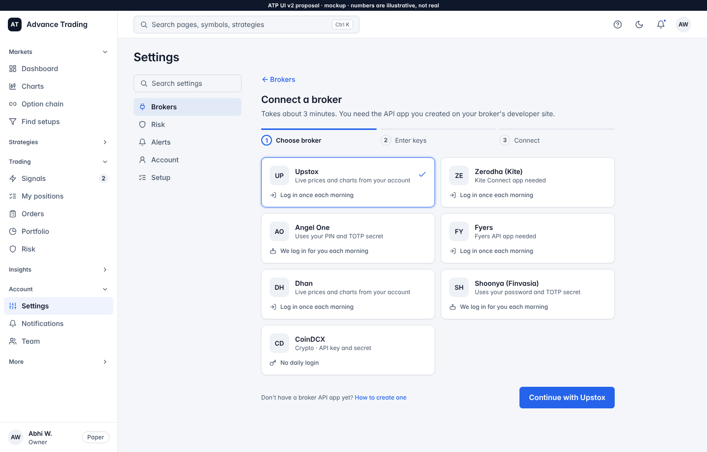
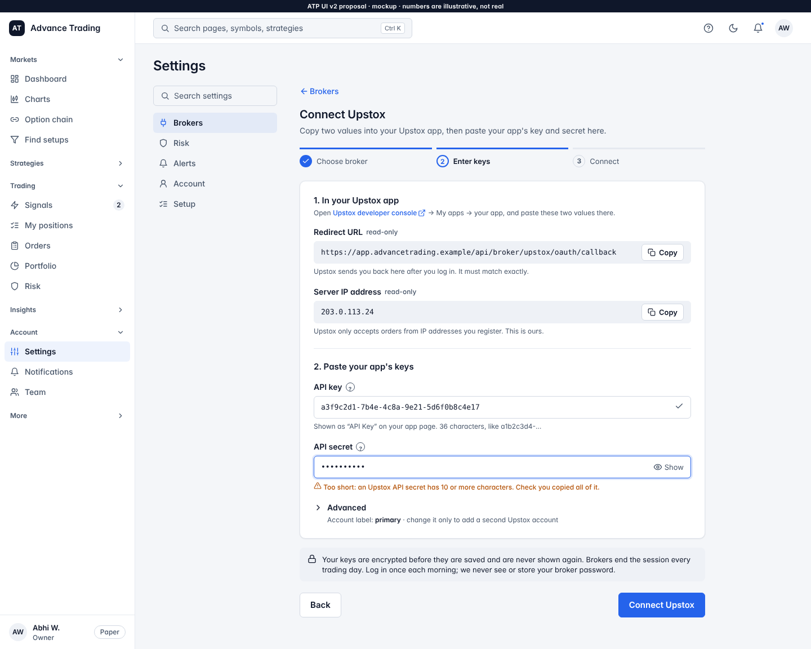
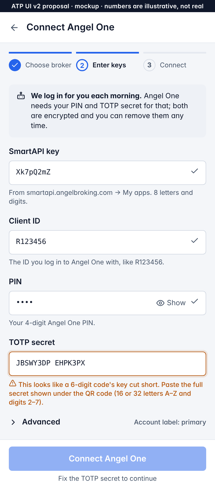
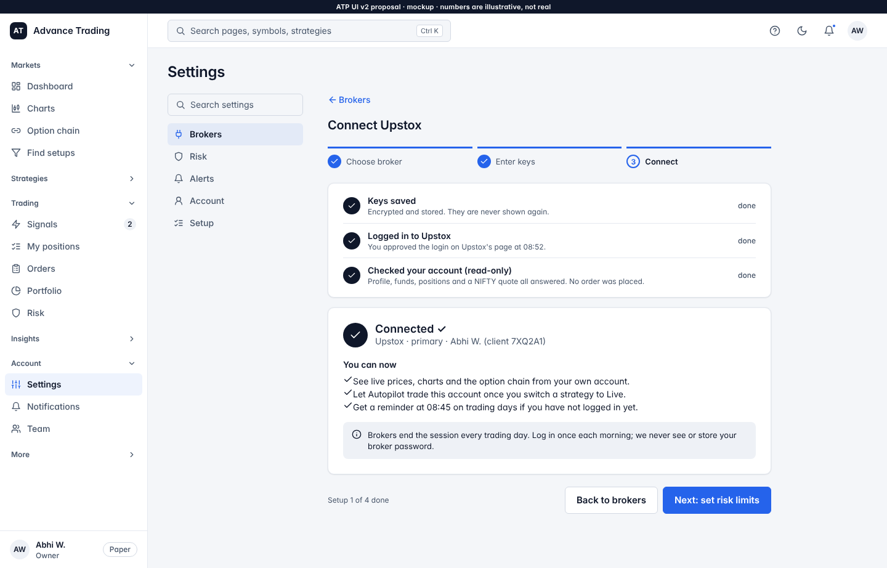
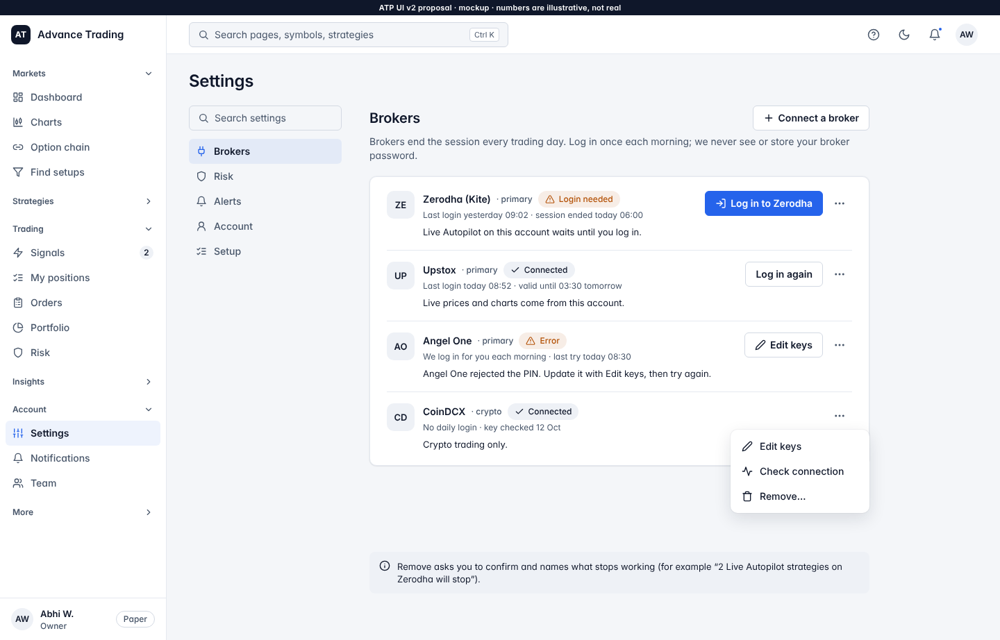

### The flow

**1. Choose a broker.** Tiles come from the registry: name, neutral monogram (no third-party logos, UI-12), and one line on how login works:

- "Log in once each morning";
- "We log in for you each morning";
- "No daily login".

**2. Enter that broker's fields only.** The fields come from the field map below, served by the backend. For each field:

- **Label, hint and example format.** For example "36 characters, like a1b2c3d4-…".
- **Inline validation.** The pattern and length come from the map; the server validates with the same map.
- **Show/hide for secrets.**
- **Read-only values with a Copy button.**
  - Redirect URL: the server's callback.
  - Server IP: `SERVER_EGRESS_IP` from `GET /api/compliance/static-ips`.
- **Developer console link** for the broker.
- **Access and request tokens are never typed.**
- **Account label** sits under **Advanced** (default "primary", `_clean_label` rules: 1–50 letters, digits, `-`, `_`).

**3. One "Connect <Broker>" button.** It runs four steps, each shown as a line with progress:

1. **Store the keys:** `POST /api/broker/{name}/credentials`.
2. **Broker login:**
   - OAuth: redirect to the broker, back to the callback.
   - TOTP: `POST /api/broker/{name}/authenticate`.
   - API key: `authenticate`.
3. **Read-only check:** `POST /api/broker/{name}/smoke-test`. It already never places, modifies or cancels an order.
4. **"Connected ✓".** It says what the user can now do: live prices and charts from their account; Live Autopilot once they switch a strategy to Live; a pre-open reminder (D5 `login_reminder`).

On failure, the step that failed says why and what to do. Example: "Upstox said the Redirect URL does not match. Copy it again into your Upstox app, then try again."

**Daily login, renamed.** "Authenticate" becomes **"Log in to <Broker>"**. Beside it sits one line:

- OAuth and code brokers: "Brokers end the session every trading day. Log in once each morning; we never see or store your broker password."
- TOTP brokers: "We log in for you each morning." Plus, on the keys step: "…using the PIN and TOTP secret you stored, encrypted."

The "never store your password" sentence is *not* used for TOTP brokers, because Angel One stores the PIN and Shoonya the login password (UI-6).

**Brokers list (Settings → Brokers).** One row per stored credential (`GET /api/broker/token-status` joined with `GET /api/broker/credentials` and `GET /api/accounts`). Each row has:

- **A status chip:**
  - **Connected** (neutral + check);
  - **Login needed** (amber, with the reason: "session ended today 06:00");
  - **Error** (amber, with the reason: e.g. "Angel One rejected the PIN").
- **Last login**: `last_verified_at`, and the expiry from `token_expires_at`.
- **What it affects**: e.g. "Live Autopilot on this account waits until you log in."
- **Actions:** **Log in to <Broker>** (primary only when login is needed), and **Edit keys** / **Check connection** / **Remove…** under ⋯. Remove names what stops working.

### Broker field map (from the adapters and the registry)

Sources read:

| Kind | Files and symbols |
|---|---|
| Registry | `backend/app/brokers/registry.py` (`BROKER_ADAPTERS`: zerodha, upstox, shoonya, angel_one, fyers, dhan, coindcx) |
| Credential model | `models.py` (`BrokerCredentials`: api_key, api_secret, access_token, request_token, client_id, pin, totp_secret, redirect_uri; `extra="allow"`) |
| Adapter constructors and `authenticate()` | each adapter file |
| Login methods and expiry | `token_lifecycle.py` (`OAUTH_BROKERS = {"upstox"}`, `LOGIN_URL_BROKERS` fyers/zerodha, `PERMANENT_KEY_BROKERS = {"coindcx"}`, `TOKEN_DAILY_EXPIRY_IST`), `login_reminder.login_method()` |

Login method key:

- **oauth:** the platform drives the login and captures the code.
- **code → oauth (proposed):** today the user pastes a code; v2 adds a server callback so nothing is pasted (UI-5).
- **totp-auto:** the platform logs in with stored secrets; a morning job is proposed (UI-6).
- **api-key:** no daily login.

| Broker (`name`) | Login today → v2 | User enters (label → stored field) | Read-only shown, with Copy | Never typed (platform obtains) | Daily expiry (IST) | Validation (proposed, same map client and server) |
|---|---|---|---|---|---|---|
| **Upstox** (`upstox`) | oauth → oauth | API key → `api_key` (OAuth client_id); API secret → `api_secret` | Redirect URL = `<server>/api/broker/upstox/oauth/callback` (stored as `redirect_uri` automatically, as `upstox_oauth_start` does today); Server IP (`SERVER_EGRESS_IP`); link to the Upstox developer console | `request_token` (OAuth code), `access_token` | 03:30 | api_key: UUID-like 36 chars; api_secret: 8–64 non-space chars |
| **Zerodha / Kite** (`zerodha`) | code (paste `request_token`) → **oauth via a new callback** | API key → `api_key`; API secret → `api_secret` | Redirect URL to set in the Kite developer console (new `/api/broker/zerodha/oauth/callback`); Server IP; console link | `request_token`, `access_token` | 06:00 | api_key: 8–32 lowercase letters and digits; api_secret: 16–64 chars |
| **Fyers** (`fyers`) | code (paste `auth_code`, needs `redirect_uri`) → **oauth via a new callback** | App ID → `api_key` (e.g. `XB12345-100`); Secret ID → `api_secret` | Redirect URL (new `/api/broker/fyers/oauth/callback`, stored as `redirect_uri`); Server IP; console link | `auth_code` (→ `request_token`), `access_token` | 06:00 | api_key: `^[A-Z0-9]+-\d{3}$`; api_secret: 8–64 chars |
| **Angel One** (`angel_one`) | manual → **totp-auto** | SmartAPI key → `api_key`; Client ID → `client_id`; PIN → `pin`; TOTP secret → `totp_secret` | One line: why PIN and TOTP are needed; console link; Server IP | `access_token` (JWT from login) | 05:00 | client_id: letters and digits, 4–12; pin: 4–6 digits; totp_secret: base32 `[A-Z2-7]{16,64}` (spaces stripped). A 6-digit code is refused in the wizard because it would not allow auto-login, although the adapter's `_totp_code` accepts one. |
| **Shoonya / Finvasia** (`shoonya`) | manual → **totp-auto** | User ID → `client_id`; Login password → `api_secret` (relabelled; the adapter hashes it as `pwd`); API key (vendor) → `api_key`; TOTP secret → `totp_secret`; Advanced: Vendor code `vc` (default `<uid>_API`), device id `imei` (default) | One line on why the password and TOTP are needed; Server IP | `susertoken` (session) | 06:00 | client_id: e.g. `FA12345`; totp_secret: base32. **The adapter must turn the secret into a code with `pyotp`, as Angel One does.** Today it sends the raw secret as `factor2`. |
| **Dhan** (`dhan`) | manual (pasted token) → see UI-7 | Client ID → `client_id`; Access token → `access_token` (from the Dhan web console). **The one exception to "never typed" until a consent login is built (UI-7).** | Console link; how long the token lasts; Server IP | none until the consent flow exists | 06:00 in the expiry table (to verify against Dhan's token lifetime, UI-7) | client_id: digits, 6–12; access_token: JWT shape `xxx.yyy.zzz` |
| **CoinDCX** (`coindcx`) | api-key → api-key | API key → `api_key`; API secret → `api_secret` | One line: "No daily login." | none | none (`PERMANENT_KEY_BROKERS`) | api_key: 32–64 hex; api_secret: 32–128 chars |

**Where the map lives.** It sits in the backend registry, beside `BROKER_ADAPTERS`, as `BROKER_FIELD_SPECS: Dict[str, BrokerSpec]`. Each spec has:

- display name and tile line;
- `login_method`;
- `fields`: key, label, kind `text|secret|readonly`, hint, example, pattern, min/max, advanced;
- `readonly`: `redirect_url`, `server_ip`;
- `console_url`;
- `daily_expiry`.

It is served by a new **`GET /api/broker/specs`**. `store_broker_credentials` validates with the same spec: it rejects unknown or typed token fields and checks patterns, returning plain-language messages. The spec also becomes the single source for `OAUTH_BROKERS`, `LOGIN_URL_BROKERS` and `login_method()`, so they cannot drift. A test asserts that every registered adapter has a spec, and that every field an adapter's constructor or `authenticate()` reads appears in its spec.

---

## 11. Setup wizard

Opens on first sign-in. It is skippable at any step ("Skip for now") and resumable: progress is stored on the server per user, and the dashboard chip "Setup 2 of 4 · Next: set your risk limits" stays until all 4 steps are done or dismissed. The wizard also lives at **Settings → Setup**, together with the moved go-live checklist (`GET /api/readiness`).

**Accepted (UI2-7):** the wizard opens by itself only while no step is done (and never for a VIEWER), so a new member who joins an organisation that is already set up sees the Setup chip on the dashboard, not the auto-opened wizard.

| Step | Title | What the user does | Done when | Reuses |
|---|---|---|---|---|
| 1 | **Connect your broker** | The 3-step Connect flow (§10). "I'll trade on paper first" skips it. | A credential is stored and the smoke test passed, or skipped | Connect flow, `/broker/*` |
| 2 | **Set your risk limits** | Three fields with defaults: capital, risk per trade (1%), daily loss limit (3% of capital), plus max trades per day under Advanced. Shows "With these limits the most you can lose today is ₹3,000." | Limits saved | `/paper/risk` (`risk_by_default`), Risk form (M13) |
| 3 | **Pick your first strategy** | Choose from 3 suggested Library strategies (by style: intraday, swing, options). "Test it" runs a quick backtest; "Start on Paper Autopilot" deploys in PAPER. | One PAPER deployment or a saved backtest | Library, Backtest, Autopilot |
| 4 | **Choose your alerts** | Pick channels (app push, Telegram link, email) and send a test alert. | One channel verified by a test | `AlertChannelsCard` API (`/alert-channels`, `/alerts/telegram/link-code`, test) |

---

## 12. Roll-out plan

**Flag.** **`ui_v2`**: "UI v2: the redesigned navigation and pages (layout only; places no orders)".

- It is registered in `backend/app/platform/controls.py` `FEATURE_FLAGS`. It is off by default automatically, because it is not in `DEFAULT_ON_FLAGS`.
- The usual tenant allow-list works, so Abhi can turn it on for his own organisation first.
- The frontend reads it through one shared `useFeatures()` hook.
- While it is off, every page renders exactly what it renders today.
- Each page switches on its own: the router picks `PageV2 ?? Page` per page, so a half-finished v2 never shows a broken page. The old layout is kept until Abhi switches the flag on for everyone.

### Order of PRs (each small, each green on its own, flag off by default)

| PR | Content | Backend | Visual tests and screenshots |
|---|---|---|---|
| **UI2-0** Foundations | `ui_v2` flag; `useFeatures()` (one fetch for the shell, replacing the separate per-component calls); new tokens (§8) in `tokens.css` (light and dark) + `tailwind.config.js` aliases (`t14`, `t20`, `border-subtle`, `shadow-raised`, `rounded-pill`, `space-*`); `src/ui/format.ts` + tests; `src/ui/glossary.ts`; token contrast unit test; `scripts/check-v2-colours.mjs` (no raw palette hues in `*V2*.tsx`) in CI | flag registration only | Storybook Tokens story updated (before/after PNG). No app snapshot changes. |
| **UI2-1** Shell | Sidebar v2 (5 sections, collapse memory, flag-hidden items, More, role-only Admin), BottomNav v2 + More sheet, top bar with command bar (Ctrl K), "What is this page?" card component, `/charts` route (wraps the current chart for now), redirects only with the flag on | none | New baselines `shell-v2-{1440,390,360}-{light,dark}`. Existing 40 `mobile.e2e` baselines unchanged. Before/after of the sidebar and bottom bar in the PR body. |
| **UI2-2** Dashboard v2 | §5 blocks, empty states, removals | `GET /api/market/strip` (read-only) + tests | `dashboard-v2-*` at 1440/390/360 × light/dark; before = current `dashboard-*` |
| **UI2-3** Signals v2 | §7 inbox; generator moved to the Library drawer (M6); Watchtower links to Signals (M7) | `GET /api/signals/feed` (read-only, aggregates existing tables) + tests | `signals-v2-*`; e2e: approve, skip and expired paths on fixtures |
| **UI2-4** Charts v2 | §6 page, indicator menu, watchlist column, mobile controls; `?chart=` window uses the same component | none | `charts-v2-*` (canvas masked except toolbar and axes for stability) |
| **UI2-5** Broker field map | `BROKER_FIELD_SPECS`, `GET /api/broker/specs`, server validation with the same map; Zerodha and Fyers callbacks; Shoonya TOTP code fix; spec-coverage test | yes (no UI change) | none (API tests) |
| **UI2-6** Connect broker + Settings v2 | §10 flow and list; Settings groups and search; "Log in to <Broker>" wording; static IP inside the flow | uses UI2-5 | `settings-v2-*`, `broker-connect-v2-{1,2,3}-*`; e2e: Upstox OAuth return, TOTP validation error, smoke-test failure message |
| **UI2-7** Setup wizard | §11; dashboard chip; go-live checklist moved to Settings → Setup | `GET/PUT /api/me/setup` (progress per user) | `setup-v2-step{1..4}-390-light` + dashboard with chip |
| **UI2-8** Merges | M1 Find setups, M2 Option chain + Plan a trade, M3 Journal Coach tab + Help panel, M4 Account → Settings, M5 Orders trade history; redirects | none | `screener-v2-*`, `option-chain-v2-*`, `orders-v2-*`, `journal-v2-*` |
| **UI2-9a…e** Page sweep | Remaining pages, 2–3 per PR: titles, one primary action, cards, formatters, empty states, error copy, tooltips. Order: (a) Positions, Portfolio, Risk · (b) Library, Builder, Backtest · (c) Autopilot, Copilot shell · (d) Performance, News & events, Company research · (e) Notifications, Team, More pages | none | One `*-v2-*` baseline set per page touched |
| **UI2-10** Switch and clean-up | After Abhi turns `ui_v2` on for everyone and two weeks pass without open issues: delete the old layouts and old baselines, remove the flag check (flag kept as a kill switch for one more release) | none | Old baselines removed; v2 baselines renamed to the plain names |

### Before/after and visual regression, per PR

- **Before/after screenshots** go in the PR description. They show each touched page at 1440 and 390, light and dark, produced by the same Playwright fixtures: the flag off gives "before", the flag on gives "after".
- **Separate v2 baselines.** `e2e/mobile.e2e.ts` gets a `ui_v2` fixture switch (`mockApi.ts` returns `ui_v2: true` from `/system/features`). v2 baselines are named `<page>-v2-<width>-<theme>.png`, so **the existing baselines in `e2e/__screenshots__/` stay untouched and keep proving the old layout did not change**. A desktop 1440 project is added for v2 pages.
- **Only the baselines of the page the PR changes are updated.** The PR lists them.
- **Each v2 page also passes** the existing phone checks: no sideways scroll, 44 px targets, nothing hidden behind the bottom bar. The token contrast test and the colour lint run in CI.
- **Bundle budget.** `scripts/check-bundle-budget.mjs` stays green. v2 pages are lazy chunks like today's.

---

## 13. Open questions (to log as OPEN_QUESTIONS rows UI-1…)

Format matches `docs/journal/OPEN_QUESTIONS.md`: question, provisional default + reason, applies to, status.

| # | Question | Provisional default + reason | Applies to | Status |
|---|---|---|---|---|
| UI-1 | Default theme for v2: light, dark or follow the system? | **Follow the system**, light when unknown. The mockups are light, and today's default is dark (`theme.ts`). A trader who set a theme keeps it. | UI2-0 | **answered 2026-10-20 (owner): default** |
| UI-2 | Is "Signals" in the Trading section acceptable (5 items, not the brief's 4)? | **Yes.** It is a bottom-bar destination and needs a desktop home. Alternative: Markets. | UI2-1 | **answered 2026-10-20 (owner): default** |
| UI-3 | New read-only `GET /api/market/strip`, or reuse three `market-data/ltp` calls plus market memory from the browser? | **New endpoint.** One call, one rate-limit budget, and it works before a broker login (falls back to market memory). Places no orders. | UI2-2 | **answered 2026-10-20 (owner): default** |
| UI-4 | New read-only `GET /api/signals/feed` aggregator? | **Yes.** No endpoint lists today's signals across Autopilot, scans and Copilot. It reads existing tables only and approvals keep using `/ai/actions`. | UI2-3 | **answered 2026-10-20 (owner): default** |
| UI-5 | Zerodha and Fyers: add server callbacks so the user never pastes a code? | **Yes.** Kite and Fyers allow a registered redirect URL. Until UI2-5 ships, the old paste box stays in the old layout only. | UI2-5 | **answered 2026-10-20 (owner): default** |
| UI-6 | TOTP brokers (Angel One, Shoonya): add a pre-open auto-login job, and store the PIN or password plus TOTP secret? | **Yes, opt-in per broker.** The job runs at 08:30 IST on trading days and uses the encrypted stored secrets. Copy says "We log in for you each morning" and never "we never store your password". Shoonya's adapter gets the `pyotp` fix first. Needs a short ADR on storing a login password. | UI2-5, UI2-6 | **answered 2026-10-20 (owner): default** |
| UI-7 | Dhan: the adapter needs an access token from the Dhan console, so it would be typed by the user. | **Keep Dhan with one clearly labelled "Paste your Dhan access token" field** (the single exception) until a consent-login flow is built. Also verify Dhan's real token lifetime against the 06:00 entry in `TOKEN_DAILY_EXPIRY_IST`. | UI2-5, UI2-6 | **answered 2026-10-20 (owner): default** |
| UI-8 | Where is wizard progress and "What is this page?" dismissal stored? | **Server-side per user** (`GET/PUT /api/me/setup`, small prefs JSON), so it follows the user across devices. `localStorage` is only a cache. | UI2-1, UI2-7 | **answered 2026-10-20 (owner): default** |
| UI-9 | Team page for non-owners? | **Visible to all roles, read-only.** Invite and role changes stay OWNER-only, as today. | UI2-1 | **answered 2026-10-20 (owner): default** |
| UI-10 | Marketplace, Factor Lab, Contract specs, Activity log: under More for everyone, or role-only? | **Under More for everyone** (flag rules still apply). Only Admin console is role-only (SUPER_ADMIN). | UI2-1 | **answered 2026-10-20 (owner): default** |
| UI-11 | Destructive actions (Remove broker, Exit all, Delete strategy): red, or neutral? | **Neutral button + a confirm dialog that names the consequence.** This keeps red for price and P&L only. Panic actions on Positions ("Exit now") keep their existing step-up and confirm. | UI2-6, UI2-9 | **answered 2026-10-20 (owner): default** |
| UI-12 | Broker tiles: real broker logos or neutral monograms? | **Neutral monograms**, to avoid trademark and branding questions. Logos only with each broker's written OK. | UI2-6 | **answered 2026-10-20 (owner): default** |
| UI-13 | When does the old layout go? | **Two weeks after Abhi turns `ui_v2` on for all organisations** with no open UI issues. Then UI2-10 removes old pages and baselines. The flag stays one more release as a kill switch. | UI2-10 | **answered 2026-10-20 (owner): default** |
| UI-14 | Does the dashboard show a signed-out view? | **No.** A signed-out visitor sees the sign-in page (`/account`). The marketing-style signed-out dashboard is removed. | UI2-2 | **answered 2026-10-20 (owner): default** |

---

## 14. Mockup index

These are static, self-contained HTML files with inline CSS. They make no network calls; Inter loads from the local system font. Each was rendered to PNG with Playwright (Chromium at `/opt/pw-browsers`). The PNGs are in `ui-v2/mockups/png/`.

| File | Viewport | Shows |
|---|---|---|
| `ui-v2/mockups/dashboard-desktop-1440.html` | 1440 | Dashboard, mid-day |
| `ui-v2/mockups/dashboard-mobile-390.html` | 390 | Dashboard, 09:05 before broker login, Setup chip |
| `ui-v2/mockups/chart-desktop-1440.html` | 1440 | Charts with the Indicators menu open, watchlist |
| `ui-v2/mockups/chart-mobile-390.html` | 390 | Charts, phone controls |
| `ui-v2/mockups/signals-desktop-1440.html` | 1440 | Signals "Today" with the detail panel |
| `ui-v2/mockups/signals-mobile-390.html` | 390 | Signals "Waiting for you" |
| `ui-v2/mockups/nav-sidebar-1440.html` | 1440 | Sidebar: trader default, all open, platform operator |
| `ui-v2/mockups/nav-bottom-mobile.html` | 2 × 390 | Bottom bar and More sheet |
| `ui-v2/mockups/broker-1-choose-1440.html` | 1440 | Connect broker, step 1 |
| `ui-v2/mockups/broker-2-keys-upstox-1440.html` | 1440 | Step 2, Upstox (read-only Redirect URL and IP, validation) |
| `ui-v2/mockups/broker-2-keys-totp-mobile-390.html` | 390 | Step 2, Angel One (TOTP), phone, validation error |
| `ui-v2/mockups/broker-3-connected-1440.html` | 1440 | Step 3, connected |
| `ui-v2/mockups/broker-list-1440.html` | 1440 | Settings → Brokers list with status chips |

`ui-v2/before/` holds today's baselines for comparison: `dashboard-390-light.png`, `signals-390-light.png` and `settings-390-light.png`, copied from `frontend/e2e/__screenshots__/`.
